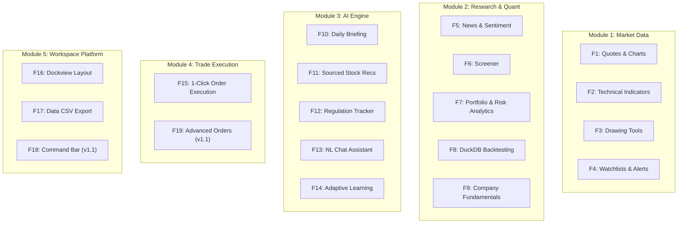

# ApexPathway — Phase 2: Feature Specifications, DTOs & API Contracts

> [!NOTE]
> **Spec-Driven Development (SDD) Guide**
> This document specifies all 19 features across 5 modules, defining exact Java data records (DTOs), REST endpoints, Server-Sent Event payloads, and frontend TypeScript interfaces.

---

## 2.1 Domain Models & Java Data Records

All core financial entities are modeled as immutable Java records in package `com.apexpathway.common.dto`:

```java
package com.apexpathway.common.dto;

import java.time.Instant;
import java.util.List;

public class DomainModels {

    // Real-Time Market Tick
    public record MarketTickDto(
        String symbol,
        String exchange,
        double ltp,
        double change,
        double changePercent,
        double high,
        double low,
        double open,
        double close,
        long volume,
        Instant timestamp
    ) {}

    // Watchlist Item Summary
    public record WatchlistTickerDto(
        String symbol,
        String name,
        String exchange,
        double ltp,
        double changePercent,
        long volume,
        List<Double> sparkline
    ) {}

    // Regulatory Circular Record
    public record RegulatoryEventDto(
        String circularId,
        String authority,        // "SEBI", "RBI", "PIB", "SEC"
        String title,
        String summary,
        List<String> affectedSectors,
        List<String> affectedTickers,
        int severity,            // 1 to 5
        double impactScore,      // -20.0 to +20.0
        String polarity,         // "BULLISH", "BEARISH", "NEUTRAL"
        String sourceUrl,
        Instant publishedAt
    ) {}

    // AI Recommendation Parameter Card
    public record AiRecommendationDto(
        String id,
        String symbol,
        String action,           // "BUY", "SELL", "HOLD"
        double entryPriceMin,
        double entryPriceMax,
        double targetPrice,
        double stopLoss,
        double riskRewardRatio,
        String timeframe,        // "INTRADAY", "SWING", "POSITIONAL"
        String confidence,       // "HIGH", "MEDIUM", "LOW"
        int compositeScore,      // 0 to 100
        String technicalRationale,
        String regulatoryRationale,
        String sourceCitationUrl,
        Instant generatedAt
    ) {}

    // One-Click Order Request Payload
    public record OrderExecutionRequest(
        String recommendationId,
        String symbol,
        String exchange,         // "NSE", "BSE"
        String side,             // "BUY", "SELL"
        String orderType,        // "MARKET", "LIMIT"
        int quantity,
        double price,
        double stopLossPrice
    ) {}

    // Order Execution Response
    public record OrderExecutionResponse(
        String orderId,
        String status,           // "SUBMITTED", "EXECUTED", "REJECTED"
        String symbol,
        int filledQuantity,
        double averagePrice,
        String message,
        Instant executedAt
    ) {}

    // Portfolio Holding Snapshot
    public record PortfolioPositionDto(
        String symbol,
        int quantity,
        double averageBuyPrice,
        double currentLtp,
        double investedValue,
        double currentValue,
        double unrealizedPnl,
        double pnlPercentage,
        double allocationPercent
    ) {}
}
```

---

## 2.2 REST & Streaming API Contracts

### Base URL: `/api/v1`

| Method | Endpoint | Description | Request Body | Response Payload |
|---|---|---|---|---|
| `GET` | `/stream/ticks` | Server-Sent Events stream for real-time market ticks. | None (Query param: `?symbols=RELIANCE,TCS,AAPL`) | `text/event-stream` emitting `MarketTickDto` |
| `GET` | `/portfolio/holdings` | Live portfolio positions and current P&L. | None | `List<PortfolioPositionDto>` |
| `POST` | `/trading/order` | Submit manual 1-click approved trade. | `OrderExecutionRequest` | `OrderExecutionResponse` |
| `POST` | `/trading/kill-switch` | Panic trigger: halts trading, revokes tokens, cancels orders. | None | `{ "status": "TERMINATED", "timestamp": "..." }` |
| `GET` | `/regulatory/events` | List latest ingested policy circulars. | Query: `?limit=20&authority=SEBI` | `List<RegulatoryEventDto>` |
| `GET` | `/ai/briefing` | Fetch today's morning briefing & top recommendations. | None | `{ "summary": "...", "recommendations": [...] }` |
| `POST` | `/ai/chat` | Natural language chat endpoint (also supports WS `/ws/ai-chat`). | `{ "query": "Why did my portfolio drop?" }` | `{ "answer": "...", "citations": [...] }` |
| `POST` | `/quant/backtest` | Run historical strategy simulation over DuckDB. | `{ "strategy": "EMA_RSI", "years": 10 }` | `{ "cagr": 0.22, "sharpe": 1.45, "drawdown": -0.14 }` |

---

## 2.3 Frontend TypeScript Interfaces (`frontend/src/types/index.ts`)

```typescript
export interface MarketTick {
  symbol: string;
  exchange: 'NSE' | 'BSE' | 'NASDAQ' | 'NYSE';
  ltp: number;
  change: number;
  changePercent: number;
  high: number;
  low: number;
  open: number;
  close: number;
  volume: number;
  timestamp: string;
}

export interface RegulatoryEvent {
  circularId: string;
  authority: 'SEBI' | 'RBI' | 'PIB' | 'SEC';
  title: string;
  summary: string;
  affectedSectors: string[];
  affectedTickers: string[];
  severity: 1 | 2 | 3 | 4 | 5;
  impactScore: number;
  polarity: 'BULLISH' | 'BEARISH' | 'NEUTRAL';
  sourceUrl: string;
  publishedAt: string;
}

export interface AiRecommendation {
  id: string;
  symbol: string;
  action: 'BUY' | 'SELL' | 'HOLD';
  entryPriceMin: number;
  entryPriceMax: number;
  targetPrice: number;
  stopLoss: number;
  riskRewardRatio: number;
  timeframe: string;
  confidence: 'HIGH' | 'MEDIUM' | 'LOW';
  compositeScore: number;
  technicalRationale: string;
  regulatoryRationale: string;
  sourceCitationUrl: string;
  generatedAt: string;
}

export interface OrderPayload {
  recommendationId?: string;
  symbol: string;
  exchange: 'NSE' | 'BSE';
  side: 'BUY' | 'SELL';
  orderType: 'MARKET' | 'LIMIT';
  quantity: number;
  price: number;
  stopLossPrice: number;
}
```

---

## 2.4 Detailed Feature Acceptance Matrix (19 Features)



### Module 1: Market Data & Visualization
* **F1: Real-time Quotes & Charts**
  - *Acceptance Test:* Angel One binary stream feeds candlestick charts with $<250\text{ms}$ latency.
* **F2: Technical Indicators**
  - *Acceptance Test:* RSI(14), EMA(20, 50, 200), and VWAP overlays computed via TA4J in Java and rendered on TradingView chart.
* **F3: Drawing Tools**
  - *Acceptance Test:* User can draw horizontal lines and trendlines; coordinates persist in localStorage.
* **F4: Watchlists & Alerts**
  - *Acceptance Test:* Price crossing trigger emits browser desktop notification within 1 second.

### Module 2: Analysis & Research
* **F5: News Feed & Sentiment Analysis**
  - *Acceptance Test:* RSS headlines tagged with stock chips and $-1.0 \dots +1.0$ polarity scores via Gemini.
* **F6: Stock Screener**
  - *Acceptance Test:* Multi-parameter filtering (e.g. $P/E < 20 \text{ AND } RSI > 50$) executes over cached Nifty 500 in $<100\text{ms}$.
* **F7: Portfolio Tracking & Risk Analytics**
  - *Acceptance Test:* Angel One API holdings sync matches real portfolio; computes Beta, Sharpe, and Max Drawdown.
* **F8: Backtesting Engine**
  - *Acceptance Test:* Runs 10-year simulation in DuckDB with $0.1\%$ STT and ₹20 brokerage deducted per order.
* **F9: Company Fundamentals**
  - *Acceptance Test:* Displays 5-year historical P/E, ROE, and Debt/Equity metrics.

### Module 3: AI Engine
* **F10: AI Daily Briefing**
  - *Acceptance Test:* Renders overnight portfolio delta, top regulatory shifts, and 3–5 stock picks before 09:00 IST.
* **F11: AI Stock Recommendations**
  - *Acceptance Test:* Every recommendation card specifies Action, Entry, Target, and Stop-Loss with $\ge 2:1$ reward-to-risk.
* **F12: AI Regulation Tracker**
  - *Acceptance Test:* SEBI/RBI circulars extracted into JSON with severity ratings within 30 minutes of publication.
* **F13: AI Chat Interface**
  - *Acceptance Test:* Context-aware streaming chat answers portfolio inquiries with cited sources.
* **F14: AI Learning & Personalisation**
  - *Acceptance Test:* Rejection of small-cap picks lowers small-cap candidate ranking in future sessions.

### Module 4: Trading
* **F15: One-Click Trade Execution**
  - *Acceptance Test:* User approves modal; order is acknowledged by Angel One SmartAPI and order ID returned.
* **F19: Advanced Order Types (Post-MVP v1.1)**
  - *Acceptance Test:* GTT and bracket order structures.

### Module 5: Platform
* **F16: Custom Dashboard Layout**
  - *Acceptance Test:* Dockview panels dock, split, and persist state across page refreshes.
* **F17: Data Export**
  - *Acceptance Test:* 1-click export of screener and backtest trade logs to clean `.csv` files.
* **F18: Keyboard Command Bar (Post-MVP v1.1)**
  - *Acceptance Test:* `Ctrl+K` opens ticker search palette.

---

## 2.5 Phase 2 Implementation Checklist

- [ ] Create package `com.apexpathway.common.dto` and paste `DomainModels.java`.
- [ ] Create TypeScript types in `frontend/src/types/index.ts`.
- [ ] Implement Spring Web Controller skeletons matching Section 2.2 endpoints.
- [ ] Write mock REST tests verifying serialization of `MarketTickDto` and `AiRecommendationDto`.
