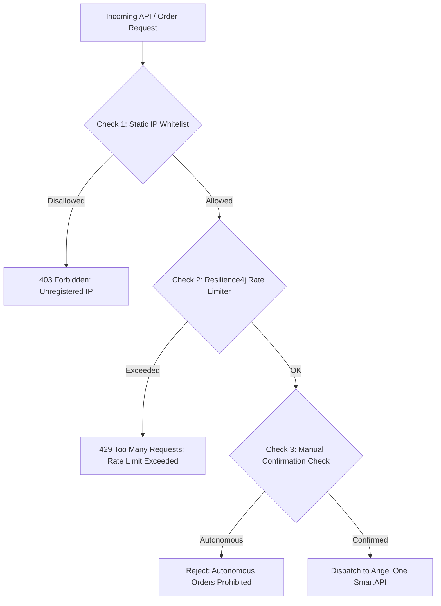

# ApexPathway — Phase 3: Regulatory & Compliance Code

> [!NOTE]
> **Spec-Driven Development (SDD) Guide**
> This document specifies the code and configuration to enforce compliance with SEBI's 2025/2026 Algorithmic Trading circular, Angel One's Static IP terms, and the non-commercial personal-use boundary.

---

## 3.1 Compliance Architecture Overview



---

## 3.2 RFC 6238 TOTP Generator (`backend/src/main/java/com/apexpathway/auth/TotpGenerator.java`)

Angel One SmartAPI mandates TOTP-based two-factor authentication. This utility computes valid 6-digit TOTP tokens automatically:

```java
package com.apexpathway.auth;

import com.eatthepath.otp.TimeBasedOneTimePasswordGenerator;
import org.apache.commons.codec.binary.Base32;
import org.springframework.stereotype.Component;

import javax.crypto.spec.SecretKeySpec;
import java.security.Key;
import java.time.Duration;
import java.time.Instant;

@Component
public class TotpGenerator {

    private final TimeBasedOneTimePasswordGenerator totpGenerator;
    private final Base32 base32 = new Base32();

    public TotpGenerator() throws Exception {
        // Standard TOTP parameters: HMAC-SHA1, 30-second time step, 6 digits
        this.totpGenerator = new TimeBasedOneTimePasswordGenerator(
            Duration.ofSeconds(30),
            6,
            TimeBasedOneTimePasswordGenerator.TOTP_ALGORITHM_HMAC_SHA1
        );
    }

    /**
     * Generates current 6-digit TOTP string from Base32 secret key.
     */
    public String generateTotp(String base32Secret) {
        try {
            byte[] decodedKey = base32.decode(base32Secret);
            Key key = new SecretKeySpec(decodedKey, "RAW");
            int code = totpGenerator.generateOneTimePassword(key, Instant.now());
            return String.format("%06d", code);
        } catch (Exception e) {
            throw new IllegalStateException("Failed to generate TOTP code: " + e.getMessage(), e);
        }
    }
}
```

---

## 3.3 Static IP Filter (`backend/src/main/java/com/apexpathway/config/StaticIpFilter.java`)

SEBI regulations mandate orders route only from an authorized Static IP:

```java
package com.apexpathway.config;

import jakarta.servlet.*;
import jakarta.servlet.http.HttpServletRequest;
import jakarta.servlet.http.HttpServletResponse;
import org.slf4j.Logger;
import org.slf4j.LoggerFactory;
import org.springframework.beans.factory.annotation.Value;
import org.springframework.core.annotation.Order;
import org.springframework.stereotype.Component;

import java.io.IOException;
import java.util.Arrays;
import java.util.List;

@Component
@Order(1)
public class StaticIpFilter implements Filter {

    private static final Logger log = LoggerFactory.getLogger(StaticIpFilter.class);

    @Value("${apexpathway.security.whitelisted-ips:127.0.0.1,0:0:0:0:0:0:0:1}")
    private String whitelistedIpsConfig;

    @Override
    public void doFilter(ServletRequest request, ServletResponse response, FilterChain chain)
            throws IOException, ServletException {
        
        HttpServletRequest req = (HttpServletRequest) request;
        HttpServletResponse res = (HttpServletResponse) response;

        // Apply strict IP check only to trading endpoints
        if (req.getRequestURI().startsWith("/api/v1/trading/")) {
            String remoteAddr = req.getRemoteAddr();
            List<String> allowedIps = Arrays.asList(whitelistedIpsConfig.split(","));

            if (!allowedIps.contains(remoteAddr.trim())) {
                log.warn("[SEBI COMPLIANCE VIOLATION] Blocked trade execution attempt from unauthorized IP: {}", remoteAddr);
                res.setStatus(HttpServletResponse.SC_FORBIDDEN);
                res.setContentType("application/json");
                res.getWriter().write("{\"error\": \"Forbidden\", \"message\": \"Orders only permitted from registered Static IP.\"}");
                return;
            }
        }

        chain.doFilter(request, response);
    }
}
```

---

## 3.4 Rate Limiting Configuration (`application.yml`)

Ensures trading and historical queries strictly respect Angel One ceilings:

```yaml
resilience4j.ratelimiter:
  instances:
    angelOrderLimiter:
      limitForPeriod: 8               # Max 8 orders/sec (below Angel One 9-10 limit)
      limitRefreshPeriod: 1s
      timeoutDuration: 500ms
    angelHistoricalDataLimiter:
      limitForPeriod: 2               # Max 2 requests/sec (below Angel One 3 req/s limit)
      limitRefreshPeriod: 1s
      timeoutDuration: 2s
    finnhubRestLimiter:
      limitForPeriod: 50              # Max 50 req/min (below Finnhub 60 limit)
      limitRefreshPeriod: 60s
      timeoutDuration: 1s
```

---

## 3.5 Personal Use Disclaimer Banner (`frontend/src/components/common/DisclaimerBanner.tsx`)

Enforces that the terminal is strictly a personal research environment:

```tsx
import React, { useState, useEffect } from 'react';
import { AlertTriangle, X } from 'lucide-react';

export const DisclaimerBanner: React.FC = () => {
  const [dismissed, setDismissed] = useState<boolean>(false);

  useEffect(() => {
    const isDismissed = sessionStorage.getItem('disclaimer_acknowledged');
    if (isDismissed) setDismissed(true);
  }, []);

  const handleAcknowledge = () => {
    sessionStorage.setItem('disclaimer_acknowledged', 'true');
    setDismissed(true);
  };

  if (dismissed) return null;

  return (
    <div className="bg-amber-950/80 border-b border-amber-600/50 px-4 py-2 text-xs text-amber-200 flex items-center justify-between z-50">
      <div className="flex items-center space-x-2">
        <AlertTriangle className="h-4 w-4 text-amber-400 shrink-0" />
        <span>
          <strong>PERSONAL RESEARCH TOOL ONLY:</strong> ApexPathway is configured strictly for personal trading automation.
          AI recommendations are quantitative signals, not registered SEBI investment advice. All orders require manual confirmation.
        </span>
      </div>
      <button 
        onClick={handleAcknowledge}
        className="p-1 hover:bg-amber-900 rounded text-amber-300 transition-colors"
        title="Acknowledge"
      >
        <X className="h-4 w-4" />
      </button>
    </div>
  );
};
```

---

## 3.6 Phase 3 Implementation Checklist

- [ ] Implement `TotpGenerator.java` and unit test with known RFC 6238 secret vectors.
- [ ] Add `StaticIpFilter.java` and configure `apexpathway.security.whitelisted-ips` in `application.yml`.
- [ ] Configure Resilience4j rate limiter YAML instances for Angel One and Finnhub.
- [ ] Add `DisclaimerBanner.tsx` to the top level of the React frontend application.
