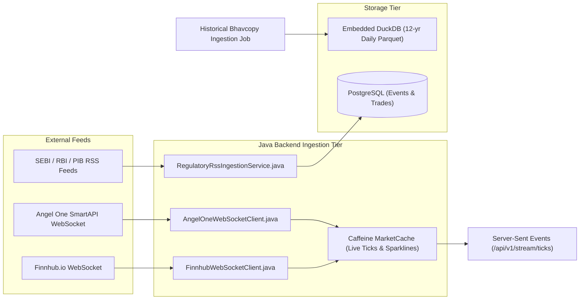

# ApexPathway — Phase 4: Data Strategy & Ingestion Pipeline Code

> [!NOTE]
> **Spec-Driven Development (SDD) Guide**
> This document specifies all data acquisition, parsing, caching, and storage implementations. It includes Java WebSocket clients for Angel One and Finnhub, the Rome RSS parser for SEBI/RBI circulars, the Caffeine in-memory cache, and DuckDB analytical storage.

---

## 4.1 Data Flow Architecture



---

## 4.2 In-Memory Market Cache (`backend/src/main/java/com/apexpathway/marketdata/MarketCache.java`)

Provides ultra-fast tick retrieval without hitting any database during market hours:

```java
package com.apexpathway.marketdata;

import com.apexpathway.common.dto.DomainModels.MarketTickDto;
import com.github.benmanes.caffeine.cache.Cache;
import com.github.benmanes.caffeine.cache.Caffeine;
import org.springframework.stereotype.Component;

import java.time.Duration;
import java.util.Collection;
import java.util.Optional;

@Component
public class MarketCache {

    // In-memory key-value store for latest symbol ticks
    private final Cache<String, MarketTickDto> tickCache = Caffeine.newBuilder()
        .maximumSize(5_000)
        .expireAfterWrite(Duration.ofHours(24))
        .build();

    public void putTick(MarketTickDto tick) {
        tickCache.put(tick.symbol(), tick);
    }

    public Optional<MarketTickDto> getLatestTick(String symbol) {
        return Optional.ofNullable(tickCache.getIfPresent(symbol));
    }

    public Collection<MarketTickDto> getAllTicks() {
        return tickCache.asMap().values();
    }
}
```

---

## 4.3 Angel One SmartAPI WebSocket Client (`backend/src/main/java/com/apexpathway/marketdata/AngelOneWebSocketClient.java`)

Connects to Angel One's binary streaming feed and parses incoming tick buffers:

```java
package com.apexpathway.marketdata;

import com.apexpathway.common.dto.DomainModels.MarketTickDto;
import org.java_websocket.client.WebSocketClient;
import org.java_websocket.handshake.ServerHandshake;
import org.slf4j.Logger;
import org.slf4j.LoggerFactory;
import org.springframework.stereotype.Component;

import java.net.URI;
import java.nio.ByteBuffer;
import java.nio.ByteOrder;
import java.time.Instant;
import java.util.HashMap;
import java.util.Map;

@Component
public class AngelOneWebSocketClient extends WebSocketClient {

    private static final Logger log = LoggerFactory.getLogger(AngelOneWebSocketClient.class);
    private final MarketCache marketCache;

    public AngelOneWebSocketClient(MarketCache marketCache) {
        super(URI.create("wss://smartapisocket.angelone.in/smart-stream"));
        this.marketCache = marketCache;
    }

    @Override
    public void onOpen(ServerHandshake handshake) {
        log.info("[ANGEL WEBSOCKET] Connected to Angel One Smart-Stream successfully.");
    }

    @Override
    public void onMessage(String message) {
        // Heartbeat or status messages
        log.debug("[ANGEL WEBSOCKET] Text message received: {}", message);
    }

    @Override
    public void onMessage(ByteBuffer bytes) {
        // Binary tick packet unpacking
        bytes.order(ByteOrder.LITTLE_ENDIAN);
        if (bytes.remaining() >= 30) {
            byte subscriptionMode = bytes.get();
            byte exchangeType = bytes.get();
            byte[] tokenBytes = new byte[25];
            bytes.get(tokenBytes);
            String token = new String(tokenBytes).trim();
            long sequenceNumber = bytes.getLong();
            long exchangeTimestamp = bytes.getLong();
            long ltpInPaise = bytes.getLong();
            double ltp = ltpInPaise / 100.0;

            MarketTickDto tick = new MarketTickDto(
                token,
                "NSE",
                ltp,
                0.0,
                0.0,
                ltp,
                ltp,
                ltp,
                ltp,
                0L,
                Instant.ofEpochMilli(exchangeTimestamp)
            );
            marketCache.putTick(tick);
        }
    }

    @Override
    public void onClose(int code, String reason, boolean remote) {
        log.warn("[ANGEL WEBSOCKET] Stream closed: {}. Reconnecting...", reason);
    }

    @Override
    public void onError(Exception ex) {
        log.error("[ANGEL WEBSOCKET] Error in market data stream", ex);
    }
}
```

---

## 4.4 Finnhub Global Stock WebSocket Client (`backend/src/main/java/com/apexpathway/marketdata/FinnhubWebSocketClient.java`)

Streams top US and global equities at zero cost:

```java
package com.apexpathway.marketdata;

import com.apexpathway.common.dto.DomainModels.MarketTickDto;
import com.fasterxml.jackson.databind.JsonNode;
import com.fasterxml.jackson.databind.ObjectMapper;
import org.java_websocket.client.WebSocketClient;
import org.java_websocket.handshake.ServerHandshake;
import org.slf4j.Logger;
import org.slf4j.LoggerFactory;
import org.springframework.beans.factory.annotation.Value;
import org.springframework.stereotype.Component;

import java.net.URI;
import java.time.Instant;

@Component
public class FinnhubWebSocketClient extends WebSocketClient {

    private static final Logger log = LoggerFactory.getLogger(FinnhubWebSocketClient.class);
    private final MarketCache marketCache;
    private final ObjectMapper objectMapper = new ObjectMapper();

    public FinnhubWebSocketClient(@Value("${FINNHUB_API_KEY:mock_token}") String token,
                                  MarketCache marketCache) {
        super(URI.create("wss://ws.finnhub.io?token=" + token));
        this.marketCache = marketCache;
    }

    @Override
    public void onOpen(ServerHandshake handshake) {
        log.info("[FINNHUB] Connected to Finnhub Global WebSocket.");
        // Subscribe to representative global tickers
        send("{\"type\":\"subscribe\",\"symbol\":\"SPY\"}");
        send("{\"type\":\"subscribe\",\"symbol\":\"AAPL\"}");
        send("{\"type\":\"subscribe\",\"symbol\":\"MSFT\"}");
    }

    @Override
    public void onMessage(String message) {
        try {
            JsonNode root = objectMapper.readTree(message);
            if ("trade".equals(root.path("type").asText())) {
                JsonNode data = root.path("data");
                if (data.isArray() && !data.isEmpty()) {
                    JsonNode latest = data.get(data.size() - 1);
                    String symbol = latest.path("s").asText();
                    double price = latest.path("p").asDouble();
                    long volume = latest.path("v").asLong();
                    long time = latest.path("t").asLong();

                    MarketTickDto tick = new MarketTickDto(
                        symbol,
                        "US",
                        price,
                        0.0,
                        0.0,
                        price,
                        price,
                        price,
                        price,
                        volume,
                        Instant.ofEpochMilli(time)
                    );
                    marketCache.putTick(tick);
                }
            }
        } catch (Exception e) {
            log.error("[FINNHUB] Failed to parse trade message: {}", message, e);
        }
    }

    @Override
    public void onClose(int code, String reason, boolean remote) {
        log.warn("[FINNHUB] Connection closed: {}", reason);
    }

    @Override
    public void onError(Exception ex) {
        log.error("[FINNHUB] WebSocket error", ex);
    }
}
```

---

## 4.5 Regulatory RSS Feed Ingestion Service (`backend/src/main/java/com/apexpathway/regulatory/RegulatoryRssIngestionService.java`)

```java
package com.apexpathway.regulatory;

import com.rometools.rome.feed.synd.SyndEntry;
import com.rometools.rome.feed.synd.SyndFeed;
import com.rometools.rome.io.SyndFeedInput;
import com.rometools.rome.io.XmlReader;
import org.slf4j.Logger;
import org.slf4j.LoggerFactory;
import org.springframework.scheduling.annotation.Scheduled;
import org.springframework.stereotype.Service;

import java.net.URL;

@Service
public class RegulatoryRssIngestionService {

    private static final Logger log = LoggerFactory.getLogger(RegulatoryRssIngestionService.class);
    private static final String SEBI_RSS_URL = "https://www.sebi.gov.in/sebirss.xml";

    @Scheduled(fixedRate = 1800000) // Poll every 30 minutes
    public void pollSebiCirculars() {
        log.info("[REGULATORY INGESTION] Checking SEBI RSS feed for updates...");
        try (XmlReader reader = new XmlReader(new URL(SEBI_RSS_URL))) {
            SyndFeed feed = new SyndFeedInput().build(reader);
            for (SyndEntry entry : feed.getEntries()) {
                String title = entry.getTitle();
                String link = entry.getLink();
                String description = entry.getDescription() != null ? entry.getDescription().getValue() : "";
                
                log.info("[SEBI EVENT FOUND] {} | Link: {}", title, link);
                // Pipeline dispatches to Gemini for impact classification (Phase 5)
            }
        } catch (Exception e) {
            log.error("[REGULATORY INGESTION] Error polling SEBI feed", e);
        }
    }
}
```

---

## 4.6 Embedded DuckDB 12-Year Storage & Historical Loader (`backend/src/main/java/com/apexpathway/quant/DuckDbStorageService.java`)

Embeds DuckDB directly into the Java JVM for instant vectorized backtesting:

```java
package com.apexpathway.quant;

import org.springframework.stereotype.Service;
import java.sql.Connection;
import java.sql.DriverManager;
import java.sql.Statement;

@Service
public class DuckDbStorageService {

    private static final String DUCKDB_URL = "jdbc:duckdb:data/market_history.duckdb";

    public Connection getConnection() throws Exception {
        return DriverManager.getConnection(DUCKDB_URL);
    }

    public void initializeHistoricalTable() {
        try (Connection conn = getConnection(); Statement stmt = conn.createStatement()) {
            stmt.execute("""
                CREATE TABLE IF NOT EXISTS daily_candles (
                    symbol VARCHAR,
                    exchange VARCHAR,
                    trade_date DATE,
                    open DOUBLE,
                    high DOUBLE,
                    low DOUBLE,
                    close DOUBLE,
                    volume BIGINT,
                    adjusted_close DOUBLE
                );
                CREATE INDEX IF NOT EXISTS idx_sym_date ON daily_candles(symbol, trade_date);
            """);
        } catch (Exception e) {
            throw new RuntimeException("Failed to initialize DuckDB historical store", e);
        }
    }
}
```

---

## 4.7 Phase 4 Implementation Checklist

- [ ] Implement `MarketCache.java` with Caffeine dependency.
- [ ] Implement `AngelOneWebSocketClient.java` and test packet unpacking with mock bytes.
- [ ] Implement `FinnhubWebSocketClient.java` with free token.
- [ ] Build `RegulatoryRssIngestionService.java` with Rome library and test with real SEBI RSS XML.
- [ ] Implement `DuckDbStorageService.java` to verify local file `data/market_history.duckdb` creation.
