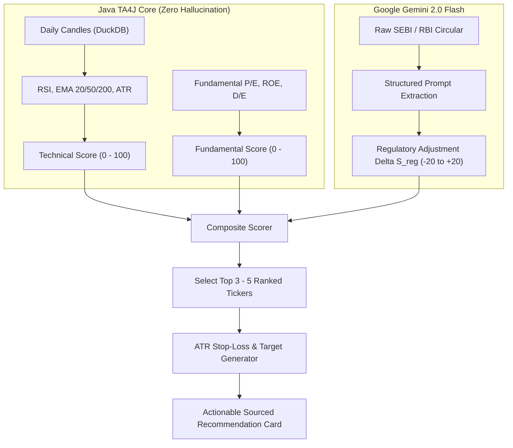

# ApexPathway — Phase 5: AI Engine Design & Quantitative Scoring Code

> [!NOTE]
> **Spec-Driven Development (SDD) Guide**
> This document specifies the complete hybrid intelligence architecture: LangChain4j integration with Google Gemini 2.0 Flash, prompt schemas for regulatory impact scoring, TA4J deterministic technical formulas, and concrete ATR-based stop-loss and price-target calculations.

---

## 5.1 Hybrid Scoring Engine Pipeline

$$\text{Final Score } S = (0.45 \cdot S_{tech}) + (0.35 \cdot S_{fund}) + (0.20 \cdot S_{reg}) + S_{user}$$



---

## 5.2 Deterministic Technical Scorer (`backend/src/main/java/com/apexpathway/quant/TechnicalScoringService.java`)

Uses TA4J to calculate mathematical indicators deterministically:

```java
package com.apexpathway.quant;

import org.springframework.stereotype.Service;
import org.ta4j.core.*;
import org.ta4j.core.indicators.*;
import org.ta4j.core.indicators.helpers.ClosePriceIndicator;
import org.ta4j.core.num.Num;

@Service
public class TechnicalScoringService {

    public record TechnicalScoreResult(
        double score,          // 0.0 to 100.0
        double rsi14,
        boolean isGoldenCross,
        double atr14,
        double currentPrice
    ) {}

    public TechnicalScoreResult calculateScore(BarSeries series) {
        ClosePriceIndicator close = new ClosePriceIndicator(series);
        
        // 1. RSI Indicator (14 periods)
        RSIIndicator rsi = new RSIIndicator(close, 14);
        double rsiVal = rsi.getValue(series.getEndIndex()).doubleValue();

        // 2. Exponential Moving Averages (50 & 200 for Golden Cross)
        EMAIndicator ema50 = new EMAIndicator(close, 50);
        EMAIndicator ema200 = new EMAIndicator(close, 200);
        double ema50Val = ema50.getValue(series.getEndIndex()).doubleValue();
        double ema200Val = ema200.getValue(series.getEndIndex()).doubleValue();
        boolean goldenCross = ema50Val > ema200Val;

        // 3. Average True Range (14 periods) for Volatility & Stops
        ATRIndicator atr = new ATRIndicator(series, 14);
        double atrVal = atr.getValue(series.getEndIndex()).doubleValue();
        double cmp = close.getValue(series.getEndIndex()).doubleValue();

        // Scoring Logic
        double score = 50.0;
        if (goldenCross) score += 20.0;
        if (rsiVal >= 50.0 && rsiVal <= 65.0) score += 20.0; // Bullish momentum without overbought
        else if (rsiVal > 70.0) score -= 15.0;                // Overbought penalty
        else if (rsiVal < 35.0) score -= 10.0;                // Weak trend

        return new TechnicalScoreResult(Math.min(100.0, Math.max(0.0, score)), rsiVal, goldenCross, atrVal, cmp);
    }
}
```

---

## 5.3 ATR-Based Parameter Generator (`backend/src/main/java/com/apexpathway/quant/TradeParameterService.java`)

Enforces minimum $2:1$ Reward-to-Risk ratio and anchors stop-losses to market volatility:

```java
package com.apexpathway.quant;

import org.springframework.stereotype.Service;

@Service
public class TradeParameterService {

    public record TradeParameters(
        double entryMin,
        double entryMax,
        double stopLoss,
        double target,
        double riskRewardRatio
    ) {}

    public TradeParameters calculateParameters(double cmp, double atr14, String action) {
        if ("BUY".equalsIgnoreCase(action)) {
            double entryMax = cmp;
            double entryMin = cmp - (0.3 * atr14);
            // Stop loss pegged to 1.8x ATR below entry
            double stopLoss = cmp - (1.8 * atr14);
            double risk = cmp - stopLoss;
            // Target calculated for 2.1x Risk-Reward
            double target = cmp + (2.1 * risk);
            double rrr = (target - cmp) / risk;

            return new TradeParameters(entryMin, entryMax, stopLoss, target, rrr);
        } else {
            // SELL / HOLD fallbacks
            return new TradeParameters(cmp, cmp, cmp * 1.05, cmp * 0.90, 2.0);
        }
    }
}
```

---

## 5.4 LangChain4j Gemini Regulatory Extraction (`backend/src/main/java/com/apexpathway/ai/GeminiRegulatoryService.java`)

```java
package com.apexpathway.ai;

import dev.langchain4j.model.chat.ChatLanguageModel;
import dev.langchain4j.model.googleai.GoogleAiGeminiChatModel;
import org.springframework.beans.factory.annotation.Value;
import org.springframework.stereotype.Service;

import java.util.List;

@Service
public class GeminiRegulatoryService {

    private final ChatLanguageModel geminiModel;

    public record RegulatoryExtractionResult(
        String summary,
        List<String> affectedSectors,
        List<String> affectedTickers,
        double regulatoryDeltaScore, // -20.0 to +20.0
        String polarity              // BULLISH, BEARISH, NEUTRAL
    ) {}

    public GeminiRegulatoryService(@Value("${GEMINI_API_KEY:mock_key}") String apiKey) {
        this.geminiModel = GoogleAiGeminiChatModel.builder()
            .apiKey(apiKey)
            .modelName("gemini-2.0-flash")
            .temperature(0.1) // Low temperature for deterministic classification
            .build();
    }

    public String classifyRegulatoryText(String circularTitle, String circularContent) {
        String prompt = String.format("""
            You are a senior financial compliance analyst for Indian stock markets.
            Analyze the following official regulatory circular and return a JSON object strictly adhering to this schema:
            {
              "summary": "2-sentence plain English summary of economic impact",
              "affectedSectors": ["BANKING", "AUTO", etc],
              "affectedTickers": ["HDFCBANK", "TATAMOTORS", etc],
              "regulatoryDeltaScore": <number between -20.0 and 20.0>,
              "polarity": "BULLISH" | "BEARISH" | "NEUTRAL"
            }

            Circular Title: %s
            Content: %s
            """, circularTitle, circularContent);

        return geminiModel.generate(prompt);
    }
}
```

---

## 5.5 Phase 5 Implementation Checklist

- [ ] Implement `TechnicalScoringService.java` using TA4J and verify RSI/EMA tests.
- [ ] Implement `TradeParameterService.java` and verify $2:1$ reward-to-risk calculations.
- [ ] Implement `GeminiRegulatoryService.java` with LangChain4j Gemini 2.0 Flash provider.
- [ ] Write integration test validating that Gemini's output parses into `RegulatoryExtractionResult`.
