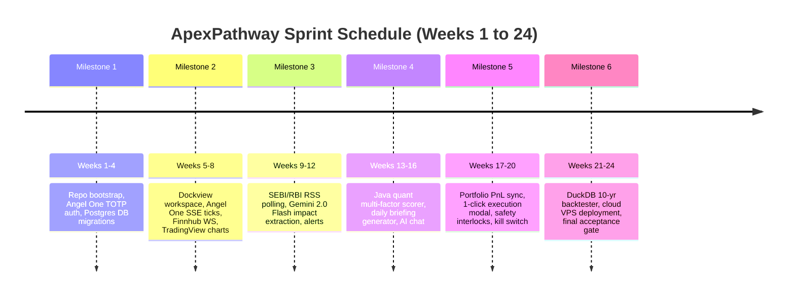

# ApexPathway — Phase 8: Roadmap & Milestone Task Execution Guide

> [!NOTE]
> **Spec-Driven Development (SDD) Guide**
> This document specifies sprint-by-sprint execution tasks, command-line verification checklists, and concrete unit/integration test specifications for each of the 6 milestones.

---

## 8.1 6-Milestone Sprint Execution Plan (24 Weeks)



---

## 8.2 Milestone 1 Test Specification: TOTP Generator (`backend/src/test/java/com/apexpathway/auth/TotpGeneratorTest.java`)

```java
package com.apexpathway.auth;

import org.junit.jupiter.api.DisplayName;
import org.junit.jupiter.api.Test;

import static org.junit.jupiter.api.Assertions.*;

class TotpGeneratorTest {

    @Test
    @DisplayName("Should generate valid 6-digit numeric TOTP code")
    void testTotpGeneration() throws Exception {
        TotpGenerator generator = new TotpGenerator();
        // Standard Base32 test secret (RFC 6238)
        String testSecret = "JBSWY3DPEHPK3PXP";

        String code = generator.generateTotp(testSecret);

        assertNotNull(code);
        assertEquals(6, code.length(), "TOTP must be exactly 6 digits");
        assertTrue(code.matches("\\d{6}"), "TOTP must contain only numeric characters");
    }
}
```

---

## 8.3 Milestone 4 Test Specification: Technical Scorer (`backend/src/test/java/com/apexpathway/quant/TechnicalScoringServiceTest.java`)

```java
package com.apexpathway.quant;

import org.junit.jupiter.api.DisplayName;
import org.junit.jupiter.api.Test;
import org.ta4j.core.BaseBarSeries;
import org.ta4j.core.BaseBarSeriesBuilder;

import java.time.ZonedDateTime;

import static org.junit.jupiter.api.Assertions.*;

class TechnicalScoringServiceTest {

    @Test
    @DisplayName("Should compute positive score on uptrending series")
    void testUptrendScoring() {
        TechnicalScoringService scorer = new TechnicalScoringService();
        BaseBarSeries series = new BaseBarSeriesBuilder().withName("TEST_SERIES").build();

        ZonedDateTime now = ZonedDateTime.now();
        // Seed 250 simulated bars with steadily rising prices
        for (int i = 0; i < 250; i++) {
            double price = 100.0 + (i * 0.5);
            series.addBar(now.plusDays(i), price, price + 1.0, price - 1.0, price, 10_000);
        }

        TechnicalScoringService.TechnicalScoreResult result = scorer.calculateScore(series);

        assertNotNull(result);
        assertTrue(result.score() > 50.0, "Uptrend series should produce score > 50");
        assertTrue(result.isGoldenCross(), "Series should have 50 EMA > 200 EMA");
        assertTrue(result.atr14() > 0, "ATR must be greater than zero");
    }
}
```

---

## 8.4 Milestone 5 Test Specification: Safety Interlock (`backend/src/test/java/com/apexpathway/trading/OrderSafetyInterlockTest.java`)

```java
package com.apexpathway.trading;

import com.apexpathway.common.dto.DomainModels.OrderExecutionRequest;
import com.apexpathway.marketdata.MarketCache;
import org.junit.jupiter.api.BeforeEach;
import org.junit.jupiter.api.DisplayName;
import org.junit.jupiter.api.Test;

import static org.junit.jupiter.api.Assertions.*;

class OrderSafetyInterlockTest {

    private OrderSafetyInterlockService interlockService;

    @BeforeEach
    void setUp() {
        MarketCache cache = new MarketCache();
        interlockService = new OrderSafetyInterlockService(cache);
    }

    @Test
    @DisplayName("Should reject order exceeding max single order value (₹50,000)")
    void testOrderValueLimit() {
        // ₹1,000 x 60 shares = ₹60,000 (exceeds ₹50k limit)
        OrderExecutionRequest oversizedOrder = new OrderExecutionRequest(
            "REC-1", "RELIANCE", "NSE", "BUY", "LIMIT", 60, 1000.0, 950.0
        );

        IllegalArgumentException ex = assertThrows(IllegalArgumentException.class, () -> {
            interlockService.validateOrder(oversizedOrder);
        });

        assertTrue(ex.getMessage().contains("exceeds maximum permitted limit"));
    }

    @Test
    @DisplayName("Should block all executions when Kill Switch is active")
    void testKillSwitchInterlock() {
        interlockService.triggerKillSwitch();

        OrderExecutionRequest normalOrder = new OrderExecutionRequest(
            "REC-2", "TCS", "NSE", "BUY", "LIMIT", 5, 3000.0, 2900.0
        );

        IllegalStateException ex = assertThrows(IllegalStateException.class, () -> {
            interlockService.validateOrder(normalOrder);
        });

        assertTrue(ex.getMessage().contains("Emergency Kill Switch is ACTIVE"));
    }
}
```

---

## 8.5 Milestone Acceptance Checklist

| Milestone | Target Weeks | Verification Command | Pass Condition |
|---|---|---|---|
| **M1** | Weeks 1–4 | `mvn test -Dtest=TotpGeneratorTest` | Valid 6-digit TOTP generated; JWT retrieved. |
| **M2** | Weeks 5–8 | `npm run test` (Vite) & manual browser check | Dockview multi-pane renders; live ticks flow. |
| **M3** | Weeks 9–12 | `mvn test -Dtest=GeminiRegulatoryServiceTest` | RSS parsed; Gemini outputs valid JSON classification. |
| **M4** | Weeks 13–16 | `mvn test -Dtest=TechnicalScoringServiceTest` | Sourced recommendation cards generated with $2:1$ RRR. |
| **M5** | Weeks 17–20 | `mvn test -Dtest=OrderSafetyInterlockTest` | Oversized orders blocked; Kill switch severs sessions. |
| **M6** | Weeks 21–24 | `mvn test -Dtest=DuckDbBacktestTest` | 10-year backtest executes in $<5$ seconds with STT/brokerage deducted. |
